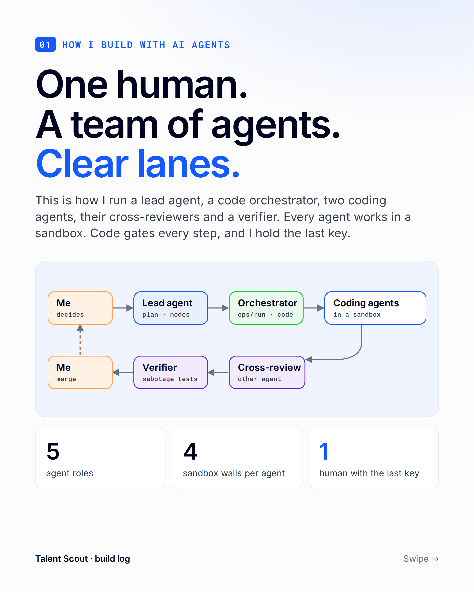
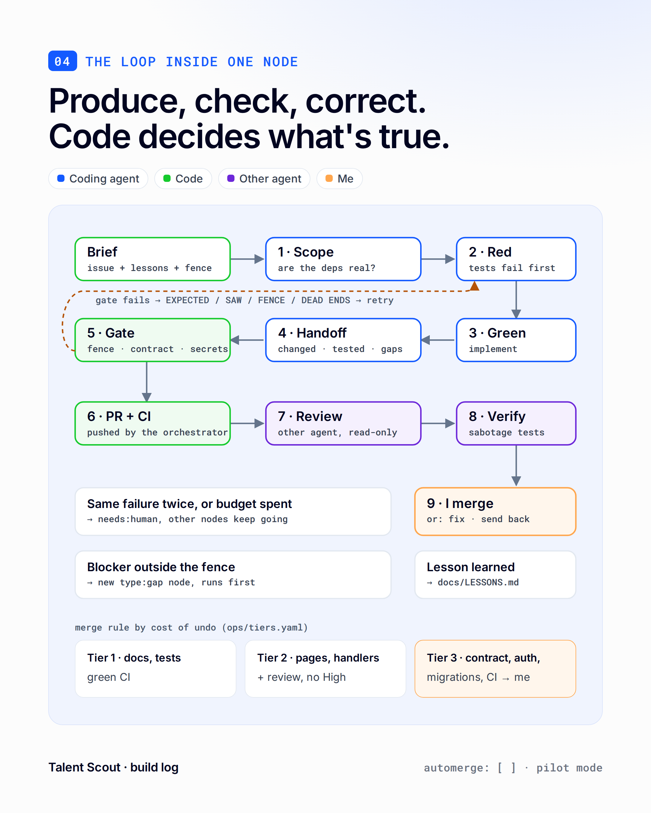
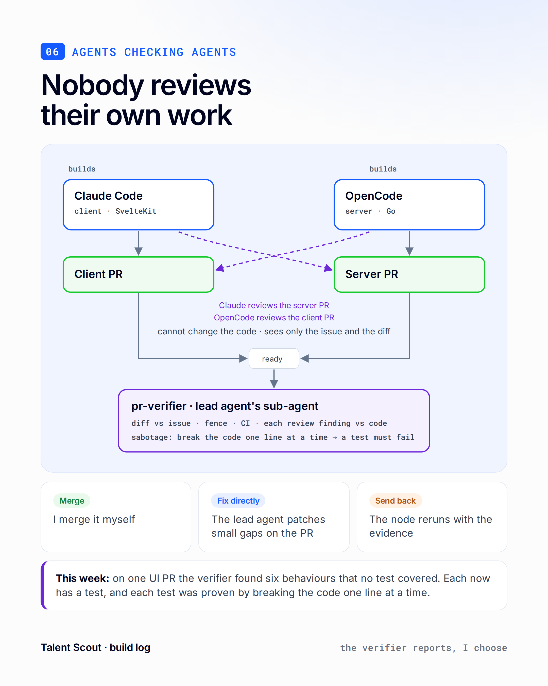
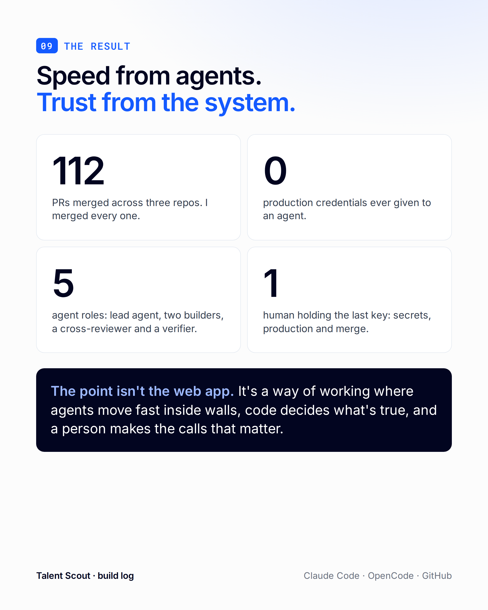
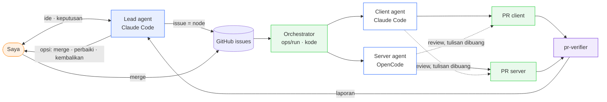
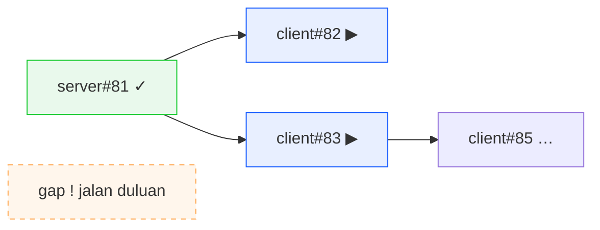
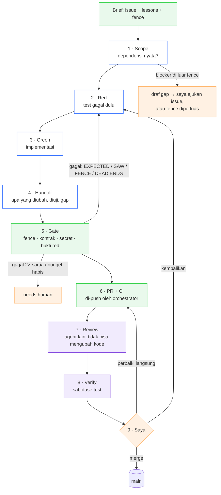
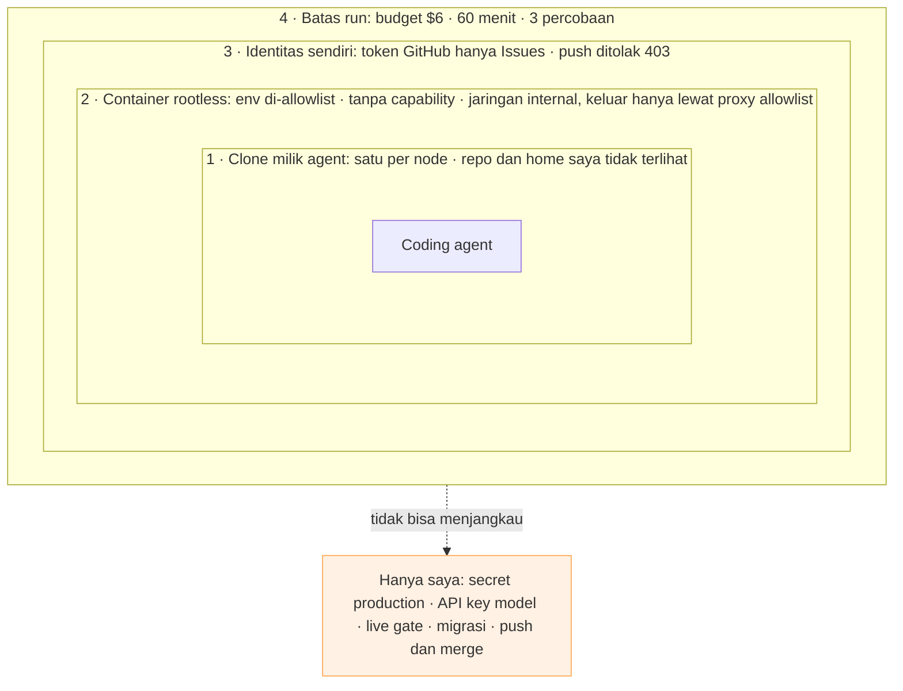
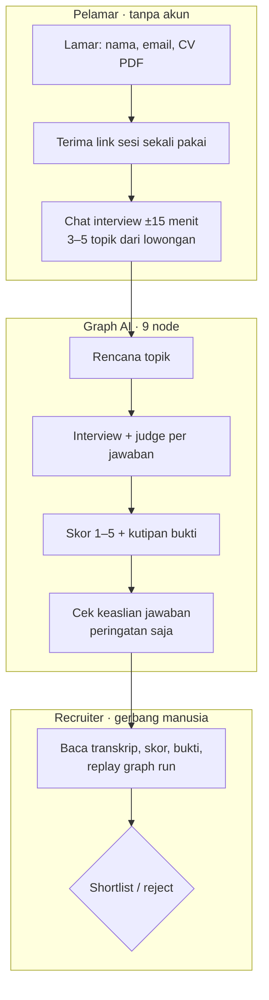

# Talent Scout: cara kerja saya dengan AI agent

Dokumen ini menjelaskan alur dari saya (manusia) sampai ke AI agent:
- loop-graph yang menjalankan pekerjaan;
- sandbox tempat agent bekerja;
- kerja sama antar agent: lead agent, orchestrator (kode), client agent, server agent, reviewer dan verifier.

Alur aplikasinya sendiri ada di bagian akhir sebagai pelengkap.

**Slide siap posting**
- `media/linkedin-workflow/` (utama, 9 slide): `slide-01.png` … `slide-09.png` berukuran 1080×1350, plus `talent-scout-agent-workflow.pdf` untuk post dokumen (carousel PDF) LinkedIn.
- `media/linkedin/` (opsional, 7 slide tentang produk): bisa dipakai untuk post kedua.

Untuk me-render ulang: `node media/render-slides.mjs linkedin-workflow talent-scout-agent-workflow.pdf`.

| | |
|---|---|
|  |  |
|  |  |
|  |  |
|  |  |
|  | |

---

## A. Peran

| Peran | Siapa | Tugas | Akses |
|---|---|---|---|
| Manusia | Saya | Menentukan apa yang dibangun; menyetujui rencana, mockup dan kontrak; menjalankan langkah production dan live gate; merge | Semua secret, production, merge |
| Lead agent | Claude Code (control plane) | Grill rencana, mockup di design canvas, menulis issue sebagai node berpagar, memverifikasi PR, memperbaiki gap kecil atas persetujuan saya | Repo dan GitHub lewat login saya, atas persetujuan per aksi; tanpa secret production |
| Orchestrator | `ops/run` (kode biasa, bukan LLM) | Memilih node yang siap, membuat sandbox, menjalankan gate, push dan membuka PR, memulai review | Login `gh` saya, hanya untuk push dan PR |
| Client agent | Claude Code | Membangun client SvelteKit: test dulu, lalu kode, lalu handoff | Sandbox |
| Server agent | OpenCode | Membangun server Go: test dulu, lalu kode, lalu handoff | Sandbox |
| Reviewer | Agent yang lain | Claude me-review PR server, OpenCode me-review PR client, hanya dari issue dan diff | Sandbox; boleh menulis, tapi semua tulisannya dibuang, jadi tidak bisa mengubah kode |
| Verifier | `pr-verifier`, sub-agent dari lead agent | Diff vs issue, fence, CI, mencocokkan temuan review dengan kode, menyabotase test | Read-only terhadap GitHub |


**Kenapa "lead agent" dan "orchestrator" dipisah?** Di banyak sistem multi-agent, orchestrator-nya adalah LLM yang memutuskan siapa mengerjakan apa. Di sini tidak:
- **Orchestrator (`ops/run`)** adalah kode deterministik. Urutan kerja, gate, izin dan push tidak diputuskan oleh model.
- **Lead agent (Claude Code)** bekerja sebelum dan sesudah loop: merencanakan bersama saya, menulis node, dan memverifikasi PR. Ia tidak pernah membagikan pekerjaan ke agent lain.



## B. Dari ide ke node

1. Saya menyampaikan ide atau masalah ke lead agent.
2. Lead agent membaca kode, mencari celahnya, lalu bertanya balik sampai semua keputusan jelas (skill `grilling`).
3. Untuk UI, mockup dibuat di design canvas bersama. Setelah saya setujui, spesifikasinya diposting di issue.
4. Perubahan kontrak (API, events, PRD) harus lewat issue `contract-change` yang saya setujui.
5. Rencana yang sudah disepakati dipecah menjadi issue. Setiap issue adalah satu node dengan blok:

```yaml
fence: [src/routes/s/*, tests/e2e/*]   # path yang boleh diubah
blocked_by: [server#81]               # dependensi yang nyata
checks: [pnpm test]                   # bukti
```

`ops/next` menghitung dari GitHub node mana yang siap: gap dijalankan dulu, lalu node yang membuka blokir paling banyak. Status tidak disimpan di dokumen.

Kalau agent menemukan blocker di luar fence-nya, ia berhenti dengan `STATUS: gap`. Token agent tidak bisa membuat issue, jadi ia menulis draf issue gap di handoff. Orchestrator hanya memblokir node pada issue gap yang benar-benar ada dan masih open, tidak pernah pada node itu sendiri (#21). Kalau belum ada, node dieskalasi dan saya yang mengajukan draf itu atau memperluas fence.



## C. Loop di dalam satu node



Aturan merge ditentukan oleh biaya undo (`ops/tiers.yaml`), dan tier-nya dihitung oleh gate, bukan dideklarasikan agent:

| Tier | Contoh | Syarat merge |
|---|---|---|
| 1 | Docs, test | CI hijau |
| 2 | Halaman, komponen, handler | + review tanpa temuan High |
| 3 | Kontrak, auth, migrasi, CI, deploy, aturan agent | + review + saya |

Saat ini `automerge: []`, jadi semua PR saya yang merge (mode pilot).

## D. Sandbox: empat dinding



- **Clone:** agent bekerja di clone miliknya sendiri (`ops/.state/clones/<repo>-<N>`). Di dalam container hanya clone itu, file handoff, dan cache dependency (overlay, tulisannya dibuang) yang terlihat. Worktree saya, `.git` saya, home saya dan `ops/env` tidak ada di sana. Fence tetap dijaga oleh gate: perubahan di luar path yang tercantum di issue ditolak.
- **Env:** hanya variabel toolchain yang di-allowlist yang diteruskan, lewat env file, bukan argumen. Database URL, API key, token dan socket saya dibuang, dan `.env` berisi secret server tidak pernah di-copy ke worktree.
- **Identitas:** token fine-grained milik agent hanya punya akses Issues. Config `gh` agent kosong, dan git ke github.com dialihkan ke HTTPS dengan token agent. Jadi GitHub sendiri yang menolak push mereka.
- **Batas run:** budget, timeout, jumlah percobaan, serta CPU, memori dan jumlah proses container diatur di `ops/tiers.yaml`. Reviewer hanya boleh membaca (Read/Glob/Grep untuk Claude, agent `plan` untuk OpenCode), dan folder kerjanya di-mount sebagai overlay yang tulisannya dibuang.
- **Jaringan:** sandbox hanya berada di jaringan Podman internal. Satu-satunya jalan keluar adalah proxy `ts-egress` dengan allowlist host persis. DNS ke luar tidak bisa, dan setiap koneksi tercatat per node.
- **Git:** agent commit di clone miliknya sendiri. Commit dibawa ke worktree saya sebagai bundle, dengan hook dimatikan.
- **Terbukti di pilot (4 node, kedua agent, tier 1–3):** `ops/run --check-sandbox` memeriksa semua dinding dari dalam image sebelum setiap sesi.

## E. Setelah merge

1. `ops/run --reconcile` menghapus label basi dan worktree yang sudah di-merge, sehingga node yang terblokir menjadi siap.
2. **Sinkronisasi kontrak:** kalau kontrak server berubah, orchestrator membuka PR sync di client. `contract.lock` mengunci commit server beserta hash file-nya.
3. **Live gate:** untuk perubahan prompt atau model, saya menjalankan tiga CV asli lewat model asli dengan key yang dibatasi. Lead agent membaca log-nya: biaya, truncation dan output.
4. **Langkah production:** migrasi dan perubahan data disiapkan dan dicoba dulu di schema `test`. Saya yang menjalankannya di production.
5. **Learning loop:** setiap node menulis pelajaran ke `docs/LESSONS.md`. Pelajaran yang terulang menjadi node `skill-update`, dan check atau lint rule lebih diutamakan daripada menambah teks.

---

## F. Sandbox diuji pada dirinya sendiri

Sebelum sandbox jadi satu-satunya mode, ia dijalankan dulu pada empat node sungguhan sebagai pilot (ADR 0002). Empat node itu mencakup kedua agent, tier 1 sampai 3, dan satu node UI. Pilot itu menemukan empat bug di sandbox-nya sendiri. Semuanya diperbaiki, dan masing-masing sekarang dijaga test:

| Bug | Gejala | Perbaikan |
|---|---|---|
| Folder induk HOME milik root | OpenCode crash sebelum start (`EACCES`), dan node tereskalasi | State, cache dan config gh dipindah ke `/tmp`, dan probe sekarang benar-benar menjalankan CLI agent (#18) |
| Log proxy tidak lengkap | Log egress kosong padahal agent bicara dengan model | tinyproxy di level Info, sehingga setiap koneksi yang diizinkan tercatat (#19) |
| Reviewer tidak bisa start | OpenCode ingin menulis `.opencode/` di mount read-only, sehingga review independen gagal | Folder reviewer jadi overlay yang tulisannya dibuang (#20) |
| Node menunggu dirinya sendiri | Draf gap dari agent menyebut nomor node-nya sendiri, dan node itu terkunci | Gap hanya bisa memblokir lewat issue nyata yang masih open (#21) |

Verifier juga bekerja di luar sandbox. Contohnya di client#91: ia menemukan enam perilaku yang lolos semua test (live region, throttle, `viewport-fit`, `theme-color`, ukuran tombol, satu tombol utama). Keenamnya sekarang dijaga test, dan setiap test dibuktikan dengan sabotase satu baris.

## Lampiran 1. Alur aplikasi

Tiga jalur: pelamar, graph AI, lalu recruiter. AI hanya membantu; keputusan selalu di tangan manusia.



## Lampiran 2. Di dalam graph AI

Graph punya lima panggilan model (biru) dan tiga pemeriksaan oleh kode (hijau). Loop retry juga dijalankan oleh kode. Setiap node dicatat sebagai event (model, token, biaya) dan bisa diputar ulang di halaman graph recruiter.

```mermaid
flowchart LR
  P[Planner<br/>LLM]:::llm --> PC[Plan check<br/>code]:::code
  PC -->|"invalid · retry"| P
  PC -- valid --> I[Interviewer<br/>LLM · 1 pertanyaan]:::llm
  I --> J[Judge<br/>LLM · cukup / follow-up]:::llm
  J --> GU[Guard<br/>code · 15 menit, 15 pertanyaan]:::code
  GU -- pertanyaan berikutnya --> I
  GU -- selesai --> S[Scorer<br/>LLM · skor + kutipan]:::llm
  S --> EC[Evidence check<br/>code · kutipan verbatim]:::code
  EC -->|"kutipan tidak ditemukan · retry ≤ 3"| S
  EC -- scored --> AU[Authenticity<br/>LLM · peringatan]:::llm
  AU -- scored --> RG[Recruiter gate<br/>manusia]:::human
  classDef llm fill:#ffffff,stroke:#145aff,stroke-width:2px
  classDef code fill:#effbf1,stroke:#16ca2e,stroke-width:2px
  classDef human fill:#fff6ec,stroke:#ffa64d,stroke-width:2px
```



---

## Lampiran 3. Keamanan AI di dalam produk

- **Blok data untrusted.** CV, jawaban dan teks lowongan masuk ke model sebagai blok data, bukan instruksi. Delimiter palsu dinetralkan.
- **Skor butuh kutipan verbatim.** Kode memeriksa setiap kutipan bukti terhadap jawaban asli.
- **Deteksi paste hanya peringatan.** Sinyal mengetik dan paste memperingatkan recruiter, tapi tidak pernah menolak pelamar atau mengubah skor.
- **Batas keras di kode.** 15 menit, 15 pertanyaan, satu pertanyaan per giliran, dan 120 kata per balasan.
- **Token yang benar.** Link sesi sekali pakai dan disimpan sebagai hash SHA-256. Token recruiter disimpan di cookie httpOnly lewat BFF.
- **Data terkunci.** RLS aktif di semua tabel tanpa policy publik, dan CV disimpan di bucket privat.

---

## Draft caption LinkedIn

**Bahasa Indonesia**

> Sebelum saya memercayai sandbox untuk AI agent saya, saya membiarkannya gagal dulu.
>
> Talent Scout dibangun oleh satu manusia dan satu tim AI agent. Setiap agent bekerja di container rootless:
> - di dalam clone miliknya sendiri, sehingga repo saya, home saya dan secret saya tidak terlihat;
> - di jaringan internal, dengan proxy yang hanya mengizinkan host tertentu dan mencatat setiap koneksi;
> - dengan token GitHub yang tidak bisa push.
>
> Sebelum sandbox itu jadi satu-satunya jalan, saya menjalankannya pada empat pekerjaan sungguhan sebagai pilot. Pilot itu menemukan empat bug di sandbox-nya sendiri: agent yang crash saat start, log yang tidak lengkap, reviewer yang tidak bisa jalan, dan tugas yang menunggu dirinya sendiri. Keempatnya diperbaiki dan kini dijaga test.
>
> Cara kerjanya:
> 🧭 Lead agent (Claude Code) menyusun rencana bersama saya dan memecahnya menjadi issue berpagar
> 🔁 Orchestrator, kode biasa dan bukan LLM, menjalankan gate
> 🛠️ Claude Code membangun client, OpenCode membangun server
> 🔍 Masing-masing di-review oleh agent yang lain, lalu verifier menyabotase test-nya
> 🔑 Saya memegang kunci terakhir: secret, production, live test, dan setiap merge
>
> 112 PR ter-merge, semuanya oleh saya. 0 credential production pernah diberikan ke agent.
>
> Agent bergerak cepat di dalam dinding. Kode memutuskan apa yang benar. Manusia membuat keputusan yang penting.
>
> #AIAgents #AIEngineering #SoftwareEngineering #DevSecOps #ClaudeCode

**English**

> Before I trusted a sandbox for my AI agents, I let it fail first.
>
> Talent Scout is built by one human and a team of AI agents. Every agent works in a rootless container:
> - inside its own clone, so my repositories, home and secrets are invisible to it;
> - on an internal network, behind a proxy that allows exact hosts and logs every connection;
> - with a GitHub token that cannot push.
>
> Before the sandbox became the only way to run, I put it through a pilot on four real tasks. The pilot found four bugs in the sandbox itself: an agent that crashed at start, an incomplete log, a reviewer that could not run, and a task left waiting on itself. All four are fixed and now guarded by tests.
>
> How the work flows:
> 🧭 A lead agent (Claude Code) plans with me and turns ideas into fenced issues
> 🔁 An orchestrator, plain code and not an LLM, runs the gates
> 🛠️ Claude Code builds the client, OpenCode builds the server
> 🔍 Each is reviewed by the other agent, then a verifier sabotages the tests
> 🔑 I hold the last key: secrets, production, live tests and every merge
>
> 112 PRs merged, every one by me. 0 production credentials ever given to an agent.
>
> Agents move fast inside walls. Code decides what's true. A person makes the calls that matter.
>
> #AIAgents #AIEngineering #SoftwareEngineering #DevSecOps #ClaudeCode
