# Talent Scout: cara kerja saya dengan AI agent

Dokumen ini menjelaskan alur dari saya (manusia) sampai ke AI agent:
- loop-graph yang menjalankan pekerjaan;
- sandbox tempat agent bekerja;
- kerja sama antar agent: lead agent, orchestrator (kode), client agent, server agent, reviewer dan verifier.

Alur aplikasinya sendiri ada di bagian akhir sebagai pelengkap.

**Slide siap posting**
- `media/linkedin-workflow/` (utama, 8 slide): `slide-01.png` … `slide-08.png` berukuran 1080×1350, plus `talent-scout-agent-workflow.pdf` untuk post dokumen (carousel PDF) LinkedIn.
- `media/linkedin/` (opsional, 7 slide tentang produk): bisa dipakai untuk post kedua.

Untuk me-render ulang: `node media/render-slides.mjs linkedin-workflow talent-scout-agent-workflow.pdf`.

| | |
|---|---|
|  | 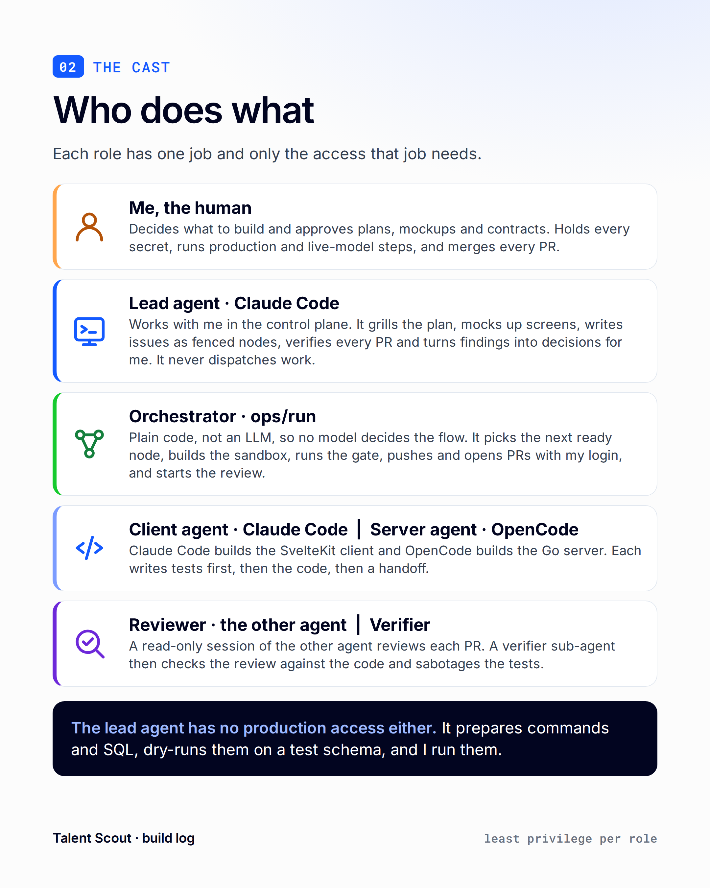 |
| 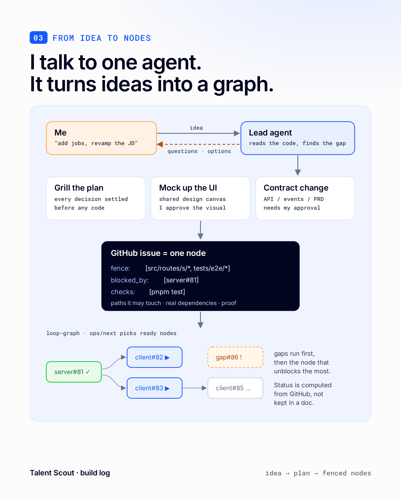 |  |
| 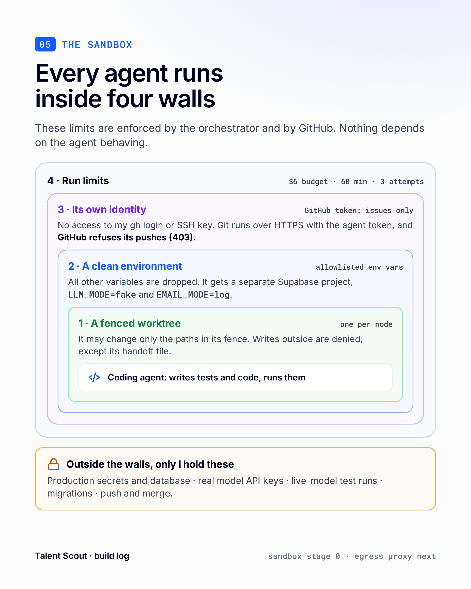 |  |
| 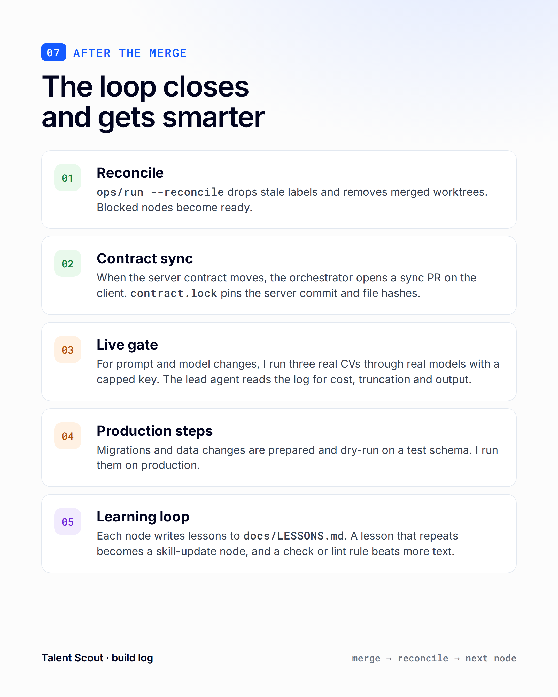 | 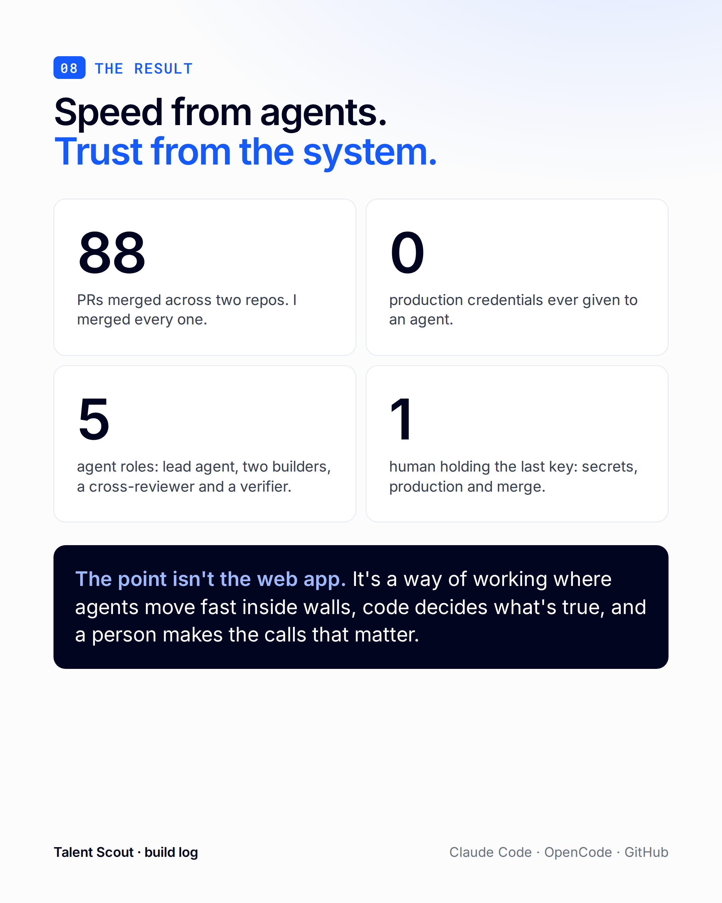 |

---

## A. Peran

| Peran | Siapa | Tugas | Akses |
|---|---|---|---|
| Manusia | Saya | Menentukan apa yang dibangun; menyetujui rencana, mockup dan kontrak; menjalankan langkah production dan live gate; merge | Semua secret, production, merge |
| Lead agent | Claude Code (control plane) | Grill rencana, mockup di design canvas, menulis issue sebagai node berpagar, memverifikasi PR, memperbaiki gap kecil atas persetujuan saya | Repo dan GitHub lewat login saya, atas persetujuan per aksi; tanpa secret production |
| Orchestrator | `ops/run` (kode biasa, bukan LLM) | Memilih node yang siap, membuat sandbox, menjalankan gate, push dan membuka PR, memulai review | Login `gh` saya, hanya untuk push dan PR |
| Client agent | Claude Code | Membangun client SvelteKit: test dulu, lalu kode, lalu handoff | Sandbox |
| Server agent | OpenCode | Membangun server Go: test dulu, lalu kode, lalu handoff | Sandbox |
| Reviewer | Agent yang lain (read-only) | Claude me-review PR server, OpenCode me-review PR client | Baca saja: issue dan diff |
| Verifier | `pr-verifier`, sub-agent dari lead agent | Diff vs issue, fence, CI, mencocokkan temuan review dengan kode, menyabotase test | Read-only terhadap GitHub |


**Kenapa "lead agent" dan "orchestrator" dipisah?** Di banyak sistem multi-agent, orchestrator-nya adalah LLM yang memutuskan siapa mengerjakan apa. Di sini tidak:
- **Orchestrator (`ops/run`)** adalah kode deterministik. Urutan kerja, gate, izin dan push tidak diputuskan oleh model.
- **Lead agent (Claude Code)** bekerja sebelum dan sesudah loop: merencanakan bersama saya, menulis node, dan memverifikasi PR. Ia tidak pernah membagikan pekerjaan ke agent lain.

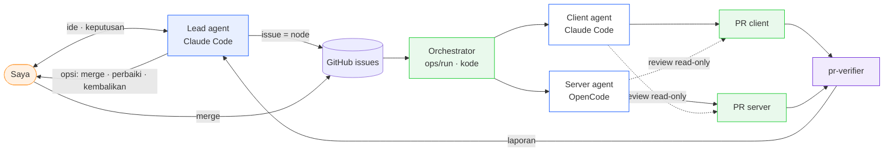

## B. Dari ide ke node

1. Saya menyampaikan ide atau masalah ke lead agent.
2. Lead agent membaca kode, mencari celahnya, lalu bertanya balik sampai semua keputusan jelas (skill `grilling`).
3. Untuk UI, mockup dibuat di design canvas bersama. Setelah saya setujui, spesifikasinya diposting di issue.
4. Perubahan kontrak (API, events, PRD) harus lewat issue `contract-change` yang saya setujui.
5. Rencana yang sudah disepakati dipecah menjadi issue. Setiap issue adalah satu node dengan blok:

```yaml
fence: [src/routes/s/*, tests/e2e/*]   # path yang boleh diubah
blocked_by: [server#81]               # dependensi yang nyata
checks: [pnpm test]                   # bukti
```

`ops/next` menghitung dari GitHub node mana yang siap: gap dijalankan dulu, lalu node yang membuka blokir paling banyak. Status tidak disimpan di dokumen.

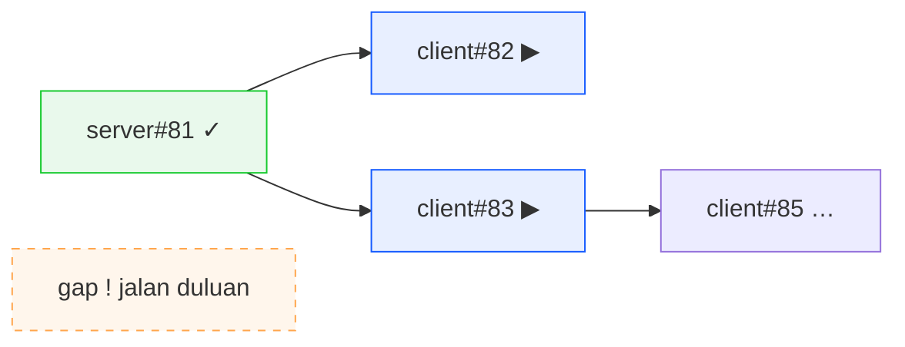

## C. Loop di dalam satu node

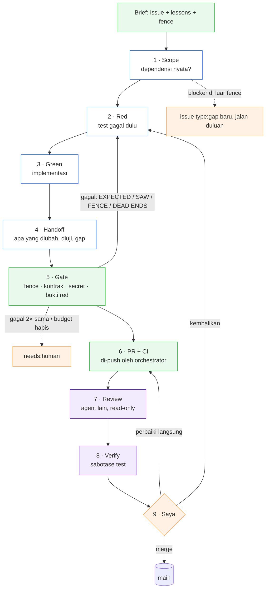

Aturan merge ditentukan oleh biaya undo (`ops/tiers.yaml`), dan tier-nya dihitung oleh gate, bukan dideklarasikan agent:

| Tier | Contoh | Syarat merge |
|---|---|---|
| 1 | Docs, test | CI hijau |
| 2 | Halaman, komponen, handler | + review tanpa temuan High |
| 3 | Kontrak, auth, migrasi, CI, deploy, aturan agent | + review + saya |

Saat ini `automerge: []`, jadi semua PR saya yang merge (mode pilot).

## D. Sandbox: empat dinding

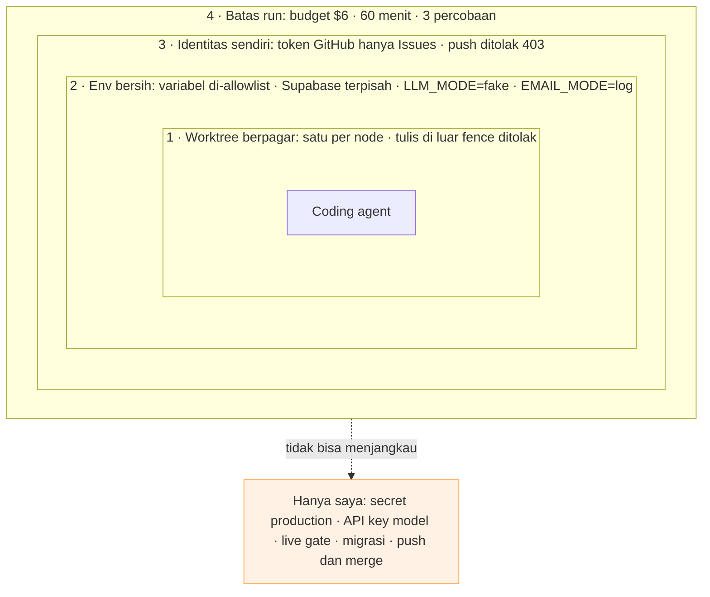

- **Worktree:** satu git worktree per node. Agent hanya boleh menulis di path fence. Di luar worktree hanya ada dua pengecualian: file handoff (`ops/.state/handoff/`) yang boleh ditulis, dan Go module cache yang boleh dibaca. Untuk OpenCode, tulis di luar itu diset `deny`, bukan `ask`.
- **Env:** hanya variabel di `AGENT_ENV_KEEP` yang diteruskan, misalnya PATH, HOME dan toolchain Go/pnpm. Database URL, API key, token dan socket saya dibuang.
- **Identitas:** token fine-grained milik agent hanya punya akses Issues. Config `gh` agent kosong, dan git ke github.com dialihkan ke HTTPS dengan token agent. Jadi GitHub sendiri yang menolak push mereka.
- **Batas run:** budget, timeout dan jumlah percobaan diatur di `ops/tiers.yaml`. Reviewer berjalan read-only: Read/Glob/Grep untuk Claude, dan agent `plan` untuk OpenCode.
- **Berikutnya (sandbox stage 1):** egress proxy untuk membatasi akses jaringan agent.

## E. Setelah merge

1. `ops/run --reconcile` menghapus label basi dan worktree yang sudah di-merge, sehingga node yang terblokir menjadi siap.
2. **Sinkronisasi kontrak:** kalau kontrak server berubah, orchestrator membuka PR sync di client. `contract.lock` mengunci commit server beserta hash file-nya.
3. **Live gate:** untuk perubahan prompt atau model, saya menjalankan tiga CV asli lewat model asli dengan key yang dibatasi. Lead agent membaca log-nya: biaya, truncation dan output.
4. **Langkah production:** migrasi dan perubahan data disiapkan dan dicoba dulu di schema `test`. Saya yang menjalankannya di production.
5. **Learning loop:** setiap node menulis pelajaran ke `docs/LESSONS.md`. Pelajaran yang terulang menjadi node `skill-update`, dan check atau lint rule lebih diutamakan daripada menambah teks.

---

## Lampiran 1. Alur aplikasi

Tiga jalur: pelamar, graph AI, lalu recruiter. AI hanya membantu; keputusan selalu di tangan manusia.

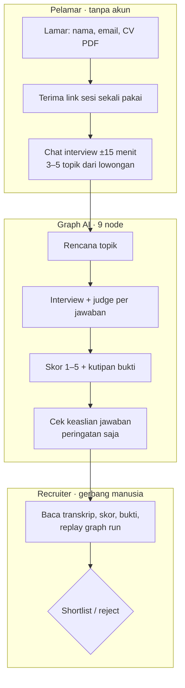

## Lampiran 2. Di dalam graph AI

Graph punya lima panggilan model (biru) dan tiga pemeriksaan oleh kode (hijau). Loop retry juga dijalankan oleh kode. Setiap node dicatat sebagai event (model, token, biaya) dan bisa diputar ulang di halaman graph recruiter.

```mermaid
flowchart LR
  P[Planner<br/>LLM]:::llm --> PC[Plan check<br/>code]:::code
  PC -->|"invalid · retry"| P
  PC -- valid --> I[Interviewer<br/>LLM · 1 pertanyaan]:::llm
  I --> J[Judge<br/>LLM · cukup / follow-up]:::llm
  J --> GU[Guard<br/>code · 15 menit, 15 pertanyaan]:::code
  GU -- pertanyaan berikutnya --> I
  GU -- selesai --> S[Scorer<br/>LLM · skor + kutipan]:::llm
  S --> EC[Evidence check<br/>code · kutipan verbatim]:::code
  EC -->|"kutipan tidak ditemukan · retry ≤ 3"| S
  EC -- scored --> AU[Authenticity<br/>LLM · peringatan]:::llm
  AU -- scored --> RG[Recruiter gate<br/>manusia]:::human
  classDef llm fill:#ffffff,stroke:#145aff,stroke-width:2px
  classDef code fill:#effbf1,stroke:#16ca2e,stroke-width:2px
  classDef human fill:#fff6ec,stroke:#ffa64d,stroke-width:2px
```

---

## Lampiran 3. Keamanan AI di dalam produk

- **Blok data untrusted.** CV, jawaban dan teks lowongan masuk ke model sebagai blok data, bukan instruksi. Delimiter palsu dinetralkan.
- **Skor butuh kutipan verbatim.** Kode memeriksa setiap kutipan bukti terhadap jawaban asli.
- **Deteksi paste hanya peringatan.** Sinyal mengetik dan paste memperingatkan recruiter, tapi tidak pernah menolak pelamar atau mengubah skor.
- **Batas keras di kode.** 15 menit, 15 pertanyaan, satu pertanyaan per giliran, dan 120 kata per balasan.
- **Token yang benar.** Link sesi sekali pakai dan disimpan sebagai hash SHA-256. Token recruiter disimpan di cookie httpOnly lewat BFF.
- **Data terkunci.** RLS aktif di semua tabel tanpa policy publik, dan CV disimpan di bucket privat.

---

## Draft caption LinkedIn

**Bahasa Indonesia**

> Yang ingin saya tunjukkan bukan aplikasinya, tapi cara aplikasi itu dibangun.
>
> Talent Scout dibangun oleh satu manusia dan satu tim AI agent, masing-masing dengan jalurnya sendiri:
>
> 🧭 Lead agent (Claude Code) menyusun rencana bersama saya, lalu memecahnya menjadi issue berpagar
> 🔁 Orchestrator, kode biasa dan bukan LLM, memilih node yang siap dan menjalankan gate
> 🛠️ Dua coding agent: Claude Code untuk client, OpenCode untuk server
> 🔍 Masing-masing di-review oleh agent yang lain, lalu verifier menyabotase test-nya
> 🧱 Setiap agent bekerja di sandbox: worktree berpagar, env bersih, token GitHub yang tidak bisa push, plus batas budget dan waktu
> 🔑 Saya memegang kunci terakhir: secret, production, live test, dan setiap merge
>
> 88 PR ter-merge. 0 credential production pernah diberikan ke agent.
>
> Agent bergerak cepat di dalam dinding. Kode memutuskan apa yang benar. Manusia membuat keputusan yang penting.
>
> #AIAgents #AIEngineering #SoftwareEngineering #DevSecOps #ClaudeCode

**English**

> The point isn't the app. It's how it gets built.
>
> Talent Scout is built by one human and a team of AI agents, each in its own lane:
>
> 🧭 A lead agent (Claude Code) plans with me and turns ideas into fenced GitHub issues
> 🔁 An orchestrator, plain code and not an LLM, picks ready nodes and runs the gates
> 🛠️ Two coding agents: Claude Code for the client, OpenCode for the server
> 🔍 Each is reviewed by the other agent, then a verifier sabotages the tests
> 🧱 Every agent works in a sandbox: a fenced worktree, a clean env, a GitHub token that can't push, plus budget and time limits
> 🔑 I hold the last key: secrets, production, live tests and every merge
>
> 88 PRs merged. 0 production credentials ever given to an agent.
>
> Agents move fast inside walls. Code decides what's true. A person makes the calls that matter.
>
> #AIAgents #AIEngineering #SoftwareEngineering #DevSecOps #ClaudeCode
